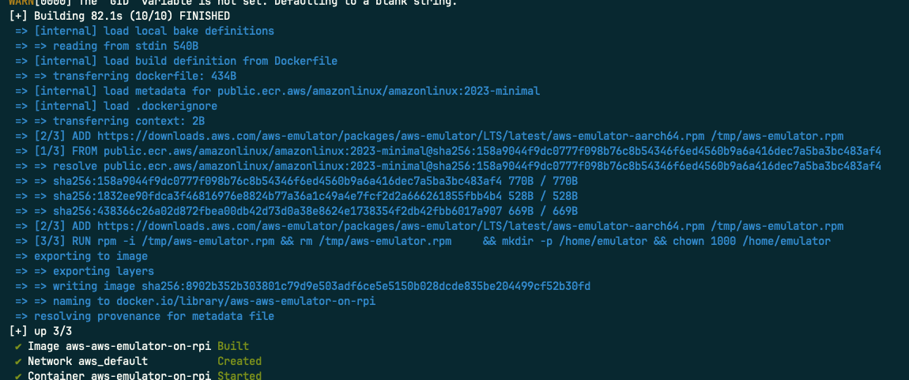

# AWS-Emulator-On-RPI
AWS emulator on Raspberry Pi

## Raspberry Pi

### setup

```bash
mkdir -p ~/.aws/emulator
sudo chown -R "$(id -u):$(id -g)" ~/.aws/emulator
```

### start
```bash
$ docker compose up -d
```



### stop

```bash
$ docker compose down
```


## Local Machine

### setup

hay que configurar el archivo ~/.aws/credentials y ~/.aws/config
para evitar estar conigurando --endpoint-url `https://<remote-ip-address>:9297` cada vez que se use el comando

```bash
$ vi ~/.aws/credentials
```

```
[emulator]
aws_access_key_id = AWSEMULATOR6
aws_secret_access_key = 123457
```

```bash
$ vi ~/.aws/config
```

```bash
$ ifconfig | grep "inet "

<remote-ip-address>
```

```
[profile emulator]
region = us-east-1
endpoint_url = https://<remote-ip-address>:9297                                       
```


## testing

```bash
$ aws --profile emulator --no-verify-ssl s3api create-bucket \
    --bucket my-bucket \
    --region us-east-1
```


```bash
$ aws --profile emulator --no-verify-ssl s3 ls \
    --region us-east-1

2026-11-14 10:21:00 my-bucket
```